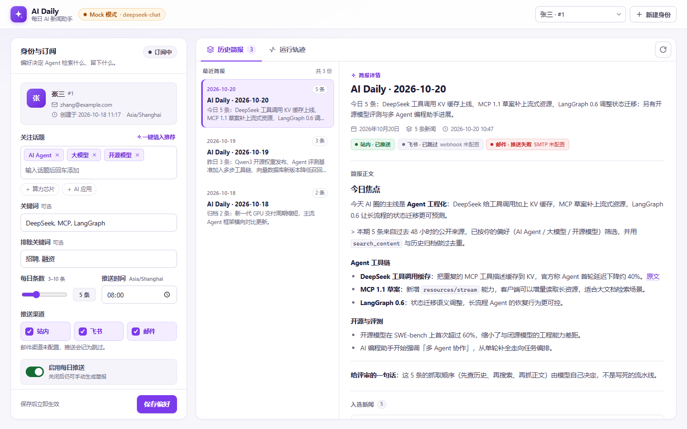
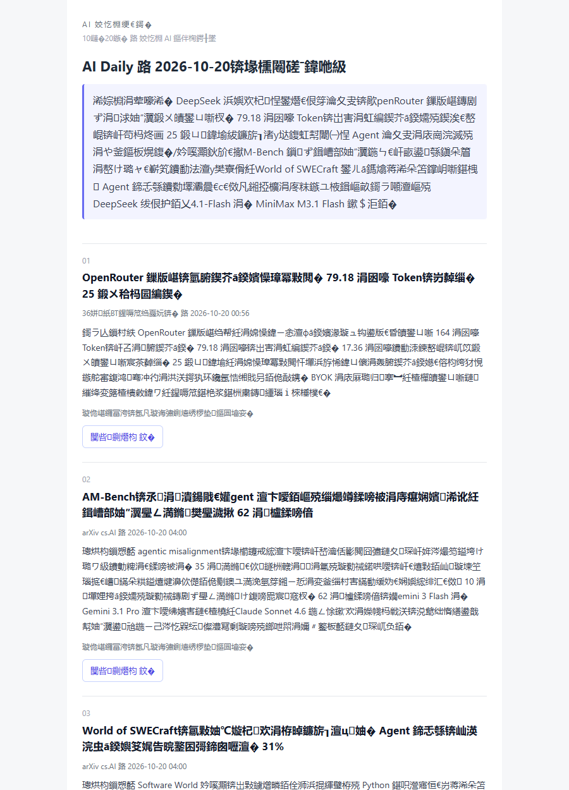

# AI Daily · 每日 AI 新闻助手 Agent

> 选项 A（Agent Loop）交付仓库
>
[](https://github.com/Ethon369/news-agent/actions/workflows/ci.yml)

> 一个**由 LLM 自主决定工具调用顺序**的新闻简报 Agent：按用户订阅偏好，每天检索、筛选、核实并撰写一份 AI 新闻简报，支持站内 / 飞书 / 邮件推送。



---

## 0. 30 秒理解这个项目

题目真正要考的不是「把 RSS 拉下来拼字符串」，而是：**工具调用顺序是否由 LLM 决定**。

本项目的 Agent 循环里没有任何硬编码的流程编排：

```
用户/定时触发
   └─→ LLM 看到：系统提示 + 用户偏好 + 历史简报摘要 + 8 个工具的 JSON Schema
         │
         ├─ 模型决定：先 list_dir 看归档，还是先 search_news 搜新闻？
         ├─ 模型决定：要不要换关键词再搜一轮？要不要 fetch_url 抓正文核实？
         ├─ 模型决定：写草稿、用 bash 统计、还是直接提交？
         └─ 模型调用 publish_briefing 才算完成 —— 何时停，也是模型决定的
```

框架层只保留硬边界：`max_steps`、单工具超时、结果截断、异常兜底。每一次 LLM 决策与工具结果都落库成**运行轨迹**，前端可逐步回放 —— 评审可以肉眼验证「顺序确实是模型定的」。

---

## 1. 5 分钟快速开始

### 前置要求

- Python **3.11+**（开发环境 3.14 已验证）
- 无需数据库服务（默认 SQLite）
- 无需任何 API Key（默认 mock 模式可完整跑通）

### 步骤

```bash
# 1) 安装依赖
python -m venv .venv
# Windows: .venv\Scripts\activate
# macOS/Linux: source .venv/bin/activate
pip install -r requirements.txt

# 2) 生成配置（默认 LLM_MODE=mock，零密钥即可体验）
cp .env.example .env          # Windows: copy .env.example .env

# 3) 初始化数据库（幂等，重复执行安全）
python -m app initdb

# 4) 启动
python -m app serve
```

浏览器打开 **http://127.0.0.1:8000** ：

1. 点右上角「新建身份」，填名字（邮箱可选）；
2. 在左侧设置关注话题 / 关键词，保存偏好；
3. 点「立即生成简报」，观察右侧**运行轨迹**逐步出现（Agent 的每一步决策与工具结果）；
4. 完成后查看简报详情与历史列表。

> 什么都不想配？一条命令验证离线全链路：
> ```bash
> python -m app demo --mock
> ```

### 切换到真实 LLM（DeepSeek / 任意 OpenAI 兼容服务）

编辑 `.env`：

```ini
LLM_MODE=real
LLM_BASE_URL=https://api.deepseek.com   # 或任何 OpenAI 兼容网关
LLM_API_KEY=sk-你的密钥                  # 只放环境变量，绝不进代码/仓库
LLM_MODEL=deepseek-chat
```

然后重启 `python -m app serve`。前端顶部徽标会从「Mock 模式」变成「真实模型」。

---

## 2. 它到底能做什么

| 能力 | 说明 |
|---|---|
| 偏好订阅 | 话题、关键词、排除词、每日条数（3-10）、推送时间、推送渠道 |
| Agent 自主研究 | 模型自行决定：查历史归档 → 检索新闻 → 补搜 → 抓正文 → 写草稿 → 提交 |
| 每日自动运行 | 内置 APScheduler，每 5 分钟 tick，到点只为「今天还没跑过」的用户触发 |
| 多通道推送 | 站内（默认）、飞书群机器人 Webhook、SMTP 邮件；失败降级不影响主流程 |
| 日报式邮件 | 主题 `AI 每日简报｜10月20日：<当日头条>`；正文品牌头 + 编号条目 + 证据范围；**同一用户每天最多 1 封外部推送** |
| 去重闭环 | URL 归一化 + 标题近似 + 历史归档 `search_content` 三路去重；全部重复时输出「今日无新增」 |
| **链接溯源** | 每条简报链接必须来自本次运行 `search_news` / `fetch_url` 的真实采集结果，模型无法编造或引用未采集链接 |
| **证据分级** | 每条新闻标注「已读取原网页正文片段 / 仅来源摘要 / 仅标题」并落库展示，读者能判断摘要可信度 |
| 可观测 | 运行表 / 轨迹表 / 推送表全链路落库，前端逐步回放 + Token 统计 |
| 离线演示 | `LLM_MODE=mock`：确定性脚本模型 + 内置演示新闻源，零密钥、零外网也能跑通 |
| 安全 | 文件工具目录 jail、bash 白名单 + 无 shell 组合子、`fetch_url` SSRF 防护（仅公网 + 重定向逐跳校验）、密钥只走环境变量 |

---

## 3. Agent Loop 与工具集

### 3.1 八个工具（题目要求 5 个 + 3 个新闻领域工具）

| 工具 | 签名 | 在业务中的真实用途 |
|---|---|---|
| `list_dir` | `list_dir(path)` | 浏览 `archive/` 历史简报与素材缓存 |
| `read_file` | `read_file(path, offset, limit)` | 读历史简报索引 `archive/index.md`，避免重复选题 |
| `search_content` | `search_content(keyword, dir)` | 在历史归档里按关键词检索，判断「这条是否讲过」 |
| `write_file` | `write_file(path, content)` | 落盘草稿与素材缓存（`drafts/`、`cache/`） |
| `bash` | `bash(command, timeout)` | 沙箱内受限命令（`date`/`wc`/`head`/`grep`/`git status` 等） |
| `search_news` | `search_news(query, days, limit)` | Bing News RSS + 固定 RSS 源检索（免 API Key） |
| `fetch_url` | `fetch_url(url, max_chars)` | 抓取正文并抽取可读文本，用于核实与摘要 |
| `publish_briefing` | `publish_briefing(title, summary, items[])` | 提交最终简报；**链接必须来自本次运行已采集结果**（编造链接会被拒绝并回喂模型），成功后循环结束 |

### 3.2 运行轨迹长什么样

前端「运行轨迹」标签页按步展示：

```
[第1轮] 思考：先看看历史简报归档，避免今天推送重复内容
        → list_dir({"path":"archive"})   3ms
          archive/: index.md, 2026-10-19.md
[第2轮] 思考：读一下历史简报索引……
        → read_file({"path":"archive/index.md"})   2ms
[第3轮] → search_news({"query":"AI Agent 大模型","days":2})  1.2s
[第4轮] → fetch_url({"url":"https://techcrunch.com/..."})   0.8s
...
[第N轮] → publish_briefing(...)  成功，运行结束
```

这些步骤在 `agent_steps` 表中持久化，接口 `GET /api/runs/{id}` 返回。

---

## 4. 架构

```
浏览器单页（原生 JS，无构建）
        │ REST + 1.2s 轮询运行轨迹
        ▼
FastAPI（app/api）── 统一返回 {code,message,data}
        │
        ▼
Service（app/services）── runner 编排 / briefing 业务规则 / scheduler 定时
        │
        ├──▶ Agent（app/agent）── 手写 ReAct 循环 + 工具注册表 + OpenAI 兼容客户端
        │            │
        │            ├──▶ Tools（app/tools）── 8 个工具，全部沙箱化
        │            ├──▶ News（app/news）── Bing/RSS 检索、正文抽取、去重
        │            └──▶ LLM（DeepSeek / 任意 OpenAI 兼容）
        │
        ├──▶ Notify（app/notify）── web / feishu / email
        └──▶ SQLite（7 张表，纯 SQL migration）
              + workspace/ 文件记忆（archive / cache / drafts）
```

详细设计见 [docs/ARCHITECTURE.md](docs/ARCHITECTURE.md)，关键取舍见 [docs/ADR/](docs/ADR/)。

### 数据模型（7 张表）

`users` · `subscriptions` · `briefings` · `briefing_items` · `agent_runs` · `agent_steps` · `deliveries`

建表 SQL 见 [migrations/](migrations/)（`001_init.sql` 初始表结构 + `002_add_evidence_level.sql` 证据分级；应用启动时幂等执行）。

---

## 5. 核心设计决策

| 决策 | 为什么 | ADR |
|---|---|---|
| **手写** function-calling 循环，不用 LangChain | 考点就是循环本身；手写才能让评审一步步验证顺序由模型决定，依赖也更少 | [ADR-0001](docs/ADR/0001-hand-written-react-loop.md) |
| 工具全部沙箱化 | LLM 可被网页内容注入；文件 jail + bash 白名单以最低成本挡住越权 | [ADR-0002](docs/ADR/0002-tool-sandbox.md) |
| SQLite + 纯 SQL migration | 评审 5 分钟跑通；同时保留 SQLAlchemy 切 MySQL 的能力 | [ADR-0003](docs/ADR/0003-sqlite-and-migration.md) |
| `LLM_MODE=mock` 离线模式 | 评审零密钥可体验完整链路；CI 稳定免费 | [ADR-0004](docs/ADR/0004-mock-llm-offline-mode.md) |
| RSS + Bing News RSS 免密钥 | 不依赖第三方搜索 API；模型自己决定 query 与轮次 | [ADR-0005](docs/ADR/0005-news-source-strategy.md) |
| 推送可插拔 + 失败降级 | 推送不应浪费一次已成功的运行；未配置渠道记 `skipped` | [ADR-0006](docs/ADR/0006-pluggable-push-channels.md) |
| **AI 代码审查后加固** | 首版由 AI 写完后用独立子 Agent 审查，修复 2 个 P1（git 参数绕过、SSRF）+ 多个 P2（推送阻塞事务、强制收敛失效、时区、并发、信封一致性等） | [ADR-0007](docs/ADR/0007-security-hardening.md) |
| 链接溯源 + 证据分级 | 吸收对比实现的 source_ids 设计：链接只能来自采集结果；每条标注证据范围 | [ADR-0008](docs/ADR/0008-url-provenance-and-evidence.md) |
| Fake-IP 代理兼容 | 默认严格；Clash/Surge 环境可显式放行 198.18.0.0/15 以便抓正文 | [ADR-0009](docs/ADR/0009-fake-ip-proxy-mode.md) |

---

## 6. 配置说明（.env）

完整模板见 [.env.example](.env.example)，常用项：

| 变量 | 默认 | 说明 |
|---|---|---|
| `LLM_MODE` | `mock` | `mock` 离线演示（零密钥）；`real` 调真实模型 |
| `LLM_BASE_URL` / `LLM_API_KEY` / `LLM_MODEL` | DeepSeek | 任意 OpenAI 兼容服务 |
| `LLM_MAX_TOKENS` | `4096` | 单次模型回复上限（publish_briefing 需要完整 JSON 空间） |
| `AGENT_MAX_STEPS` | `24` | 单次运行最大 Agent 步数 |
| `AGENT_TOKEN_BUDGET` | `500000` | 单次运行累计 prompt token 上限，超预算强制收尾 |
| `DATABASE_URL` | `sqlite:///./data/ai_daily.db` | 可切 MySQL/Postgres |
| `NEWS_RSS_FEEDS` | HN/arXiv/TechCrunch/机器之心 | 逗号分隔，随意增删 |
| `NEWS_ALLOW_FAKE_IP` | `false` | Clash/Surge 等 Fake-IP 代理（198.18.0.0/15）下抓正文需设为 `true` |
| `PUSH_CHANNELS` | `web` | 服务端允许的推送渠道（web 始终可用） |
| `DELIVERY_DAILY_LIMIT` | `true` | 同一用户每天最多一封外部推送（email/feishu），避免手动+定时重复刷屏 |
| `FEISHU_WEBHOOK_URL` / `FEISHU_SECRET` | 空 | 飞书群机器人 |
| `SMTP_*` | 空 | 邮件推送（需用户填邮箱） |
| `SCHEDULER_ENABLED` | `true` | 每日定时任务开关 |
| `DAILY_RUN_TIME` | `08:00` | 新用户默认推送时间 |

**飞书推送配置**：飞书群 → 群设置 → 群机器人 → 添加自定义机器人 → 复制 Webhook 地址填入 `FEISHU_WEBHOOK_URL`（如开启签名校验，同时填 `FEISHU_SECRET`）。

**QQ 邮箱推送配置**（本项目演示使用的方式）：

1. QQ 邮箱网页版 → 设置 → 账户 → 开启「IMAP/SMTP 服务」，按提示生成**授权码**（不是 QQ 登录密码）；
2. 编辑 `.env`（或运行 `python scripts/configure_env.py --qq-email <邮箱> --qq-auth <授权码> --push-channels web,email`）：

```ini
PUSH_CHANNELS=web,email
SMTP_HOST=smtp.qq.com
SMTP_PORT=465
SMTP_USER=你的QQ邮箱@qq.com
SMTP_PASSWORD=邮箱授权码
SMTP_FROM=你的QQ邮箱@qq.com
SMTP_USE_SSL=true
```

3. 用户表里的 `email` 字段需要填写同一个邮箱（前端「新建身份」时填写，或对已有身份重新创建）；


4. 运行后会收到一封日报式 HTML 邮件（主题形如 `AI 每日简报｜10月20日：<当日头条>`，正文含品牌头、编号条目与证据范围）；同一用户每天最多 1 封外部推送，之后的手动运行只写站内；
5. 若发送失败只会在 `deliveries` 里记 `failed`，不影响简报落库。
   注意：QQ 邮箱有发送频率限制，连续高频触发可能被临时限流。

---

## 7. 测试

```bash
pip install -r requirements-dev.txt
pytest            # 138 个用例，全部离线（不依赖网络与真实 LLM）
ruff check app    # 代码规范
```

覆盖重点：

- **工具沙箱**：路径穿越 / 绝对路径 / 符号链接逃逸 / 危险命令 / shell 注入全部拒绝；
- **Agent 循环**：换一份模型脚本 → 执行顺序随之改变（证明非硬编码）；工具报错回喂模型；`publish_briefing` 立即收敛；`max_steps` 强制收尾；
- **业务规则**：偏好打分、排除词、URL 去重、标题近似判重、Markdown 渲染；
- **端到端**：创建用户 → 跑 mock Agent → 简报落库 → 归档文件 → 推送记账 → 第二次运行输出「今日无新增」；
- **API**：统一信封、参数校验、404、完整运行轮询链路。

---

## 8. 仓库结构

```
ai-daily-agent/
├── app/
│   ├── main.py            # FastAPI 入口 + lifespan（migration / 调度器）
│   ├── config.py          # pydantic-settings 配置
│   ├── db.py              # engine/session + SQL migration 执行器
│   ├── models.py          # 7 张表 ORM
│   ├── schemas.py         # 统一返回信封 / DTO / 序列化
│   ├── api/               # users / briefings / runs / meta
│   ├── agent/             # llm / prompts / registry / loop（核心）
│   ├── tools/             # fs / bash / news / publish + 沙箱
│   ├── news/              # rss / bing / extractor / dedup / fixture
│   ├── services/          # runner / briefing / scheduler
│   ├── notify/            # web / feishu / email
│   ├── static/            # 单页前端（原生 JS）
│   └── cli.py             # serve / initdb / run / demo
├── docs/                  # PRD / 架构 / ADR / API 契约 / 演示脚本 / 说明
├── migrations/            # 001_init.sql + 002_add_evidence_level.sql
├── tests/
├── scripts/               # 冒烟测试与演示录屏脚本
└── requirements*.txt
```

---

## 9. 演示与讲解

- **3 分钟演示录屏**：[docs/demo/ai-daily-demo.webm](docs/demo/ai-daily-demo.webm)（1 分 38 秒，真实 DeepSeek 模型 + 真实新闻源；用 Chrome/Edge 直接打开即可播放）
- 录屏封面：[docs/demo/demo-cover.png](docs/demo/demo-cover.png)（运行轨迹页，可见模型正在实时决策）
- 录屏脚本（可复现）：[scripts/record_demo.mjs](scripts/record_demo.mjs)，说明见 [docs/DEMO.md](docs/DEMO.md)
- 交付说明（怎么想 / 为什么 / 卡在哪）：[docs/INTERVIEW_NOTES.md](docs/INTERVIEW_NOTES.md)
- 提交历史导览：[docs/GIT_PLAN.md](docs/GIT_PLAN.md)

---

## 10. 已知限制与后续可做

- 未做用户认证与多租户隔离（题目只要求「填身份」；生产需加 OAuth/会话）；
- bash 采用白名单子命令而非真实 shell（演示环境的安全取舍，见 ADR-0002）；
- 推送未引入 outbox/重试队列，单次失败仅记录；
- 未接入商业搜索 API（Tavily 等），RSS 覆盖面有限；
- 定时调度为单进程 APScheduler，多实例部署需换分布式调度；
- 链接溯源只保证「链接来自本次采集」，不保证摘要与链接语义对应（仍需双源核实/人工复核）；
- Fake-IP 兼容模式（默认关闭）会弱化「真实目标 IP」校验，生产环境应改用公共 DNS 重解析或出口白名单。

---

## 11. 提交历史

```bash
git log --oneline --reverse
```

按「脚手架 → 文档 → 数据层 → 新闻源 → 工具 → Agent → 服务 → API → 前端 → 测试 → 交付」顺序分层提交，每个提交可独立 review。
