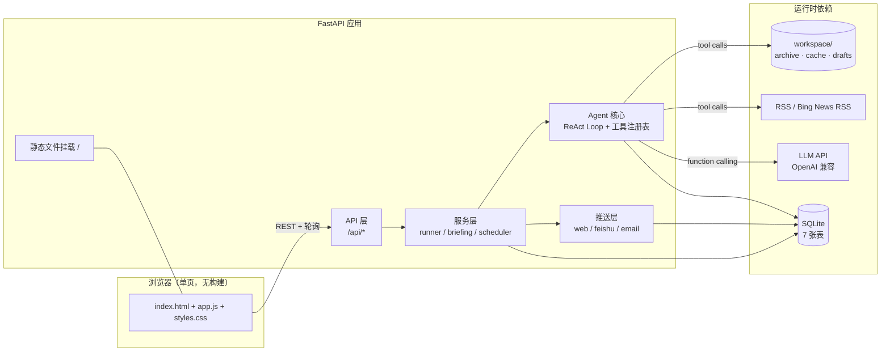
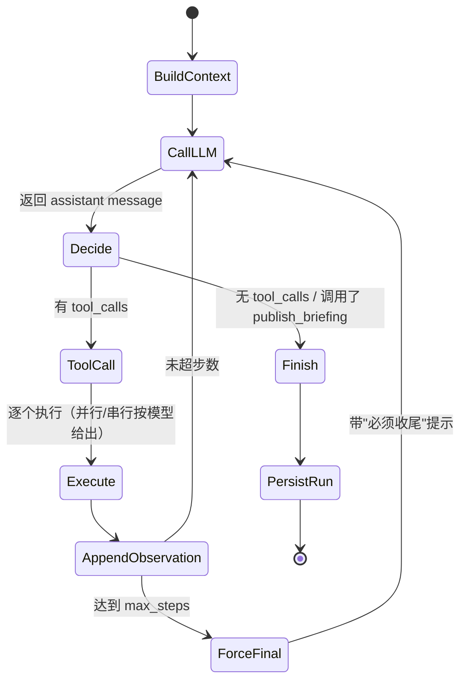
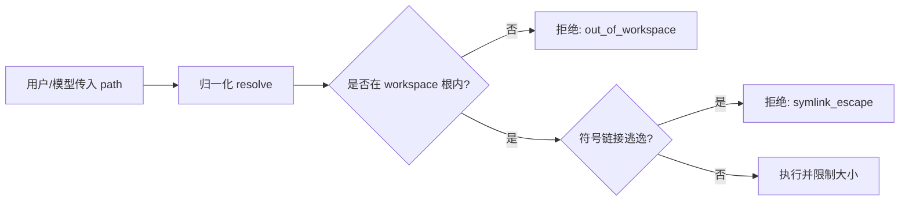
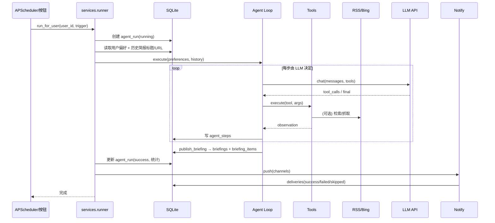
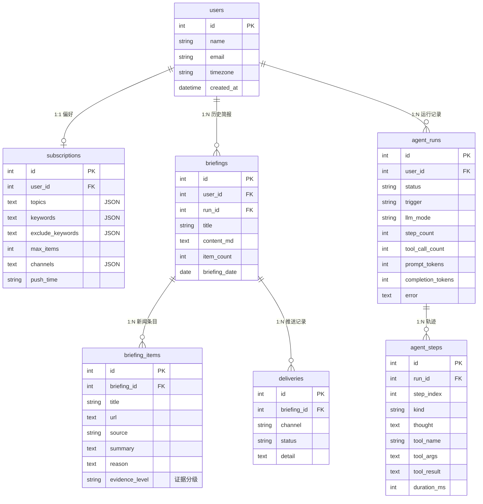

# 架构设计 —— AI Daily Agent

> 阅读顺序建议：先看 §1 总览，再看 §2 Agent Loop（核心考点），最后看 §3 工具沙箱 / §5 数据模型。

## 1. 系统总览



**分层原则**

| 层 | 目录 | 职责 | 不允许做的事 |
|---|---|---|---|
| API | `app/api/` | HTTP 协议、参数校验、统一返回结构 | 写业务逻辑、直接调 LLM |
| Service | `app/services/` | 编排一次运行的完整流程（加载偏好 → 跑 Agent → 落库 → 推送） | 直接发 HTTP 请求给 LLM |
| Agent | `app/agent/` | LLM 对话循环、工具调用、轨迹记录 | 直接写数据库表（除轨迹落库） |
| Tools | `app/tools/` | 原子能力（文件/命令/新闻/发布），全部沙箱化 | 调用其他工具或 LLM |
| News | `app/news/` | 外部新闻源的抓取与解析 | 改数据库 |
| Notify | `app/notify/` | 把简报投递到外部渠道 | 影响主流程成败 |

## 2. Agent Loop（核心考点）

### 2.1 为什么手写而不是用 LangChain

题目原文：「工具调用顺序由 LLM 决定，不是硬编码线性流程……可以用 LangChain / LangGraph / Spring AI 等现成框架，**也可以手写循环**」。本项目选择手写，原因见 [ADR-0001](ADR/0001-hand-written-react-loop.md)：本题考察的正是循环本身，手写 200 行以内的循环比引用框架更可读、更可控、也更容易被评审验证。

### 2.2 循环状态机



### 2.3 伪代码

```python
messages = [system_prompt(preferences, workspace_note), user_prompt(task)]
for step in range(max_steps):
    resp = llm.chat(messages, tools=registry.schemas(), tool_choice="auto")
    trace.record_assistant(resp.content, resp.tool_calls)
    if not resp.tool_calls:
        break                          # 模型认为可以结束
    for call in resp.tool_calls:
        result = registry.execute(call.name, call.arguments)   # 沙箱内、带超时
        trace.record_tool(call, result)
        messages.append(tool_message(call.id, result.to_llm_text()))
    if resp.finished_by_publish:       # publish_briefing 成功 → 立即收尾
        break
else:
    # 兜底：到达步数上限，强制模型用现有信息收尾
    messages.append(user_message("已达到工具调用上限，请基于已有信息给出最终结论"))
    resp = llm.chat(messages, tools=None)
```

### 2.4 关键设计点

| 设计点 | 做法 | 目的 |
|---|---|---|
| 决策权在模型 | 每轮把工具 schema + 偏好 + 历史摘要交给模型，`tool_choice="auto"` | 顺序、次数、停止由 LLM 决定 |
| 硬边界在框架 | `AGENT_MAX_STEPS`、`AGENT_TOKEN_BUDGET`、`LLM_MAX_TOKENS`、单工具超时、单条结果截断 | 防死循环/失控/成本爆炸 |
| 停止信号 | 模型不再发 tool_calls，或调用 `publish_briefing` 成功 | 两种自然结束方式 |
| 轨迹可观测 | 每步落库 `agent_steps`，SSE 轮询给前端 | 评审肉眼验证「LLM 决定顺序」 |
| 可替换模型 | `app/agent/llm.py` 只依赖 OpenAI 兼容协议 | DeepSeek/OpenAI/Qwen 可换 |
| 可离线演示 | `LLM_MODE=mock` 时 `MockLLM` 产生确定性的 tool 序列 | 评审零密钥体验、CI 稳定 |

## 3. 工具层与沙箱

### 3.1 工具注册表

`app/agent/registry.py` 维护 `ToolSpec(name, description, json_schema, handler)`：

- JSON Schema 由 Python 签名与 `pydantic` 模型生成/校验；
- 参数在进入 handler 前做类型与范围校验；
- 统一返回 `ToolResult(ok, data, error, truncated)`，再序列化为模型可读文本；
- 结果长度超过 `MAX_TOOL_RESULT_CHARS` 时截断并标记 `truncated`。

### 3.2 文件工具沙箱



- 所有文件工具只允许访问 `WORKSPACE_DIR` 内；
- 拒绝绝对路径、`..`、符号链接逃逸；
- `read_file` 限制最大字节数；`write_file` 限制单文件大小；`list_dir` 限制条目数。

### 3.3 bash 沙箱

- 命令白名单：`date` / `wc` / `head` / `tail` / `cat`（只读且限 workspace 内路径）/ `python -c` 仅限纯计算场景；
- 拒绝管道、重定向、`;`、`&&`、`$(...)`、反引号等 shell 组合子；
- 在 workspace 目录下执行，超时（默认 15s）强杀，stdout/stderr 截断；
- **的取舍**：真实生产会用容器/firejail/seccomp；这里用「参数化白名单 + 无 shell 组合子」在单机演示环境下以最小成本挡住 99% 的注入面。

## 4. 一次运行的时序（每日定时 / 手动触发）



## 5. 数据模型



## 6. 失败路径与降级

| 场景 | 行为 |
|---|---|
| LLM 超时/429 | 指数退避重试 3 次；仍失败 → `agent_run.status=failed`，错误落库，前端可见 |
| 单个新闻源失败 | 记日志继续；其余源照常 |
| 抓取正文失败 | 返回标题+摘要+链接，提示模型"正文不可用，摘要需保守" |
| 目标 URL 为内网/回环/元数据地址 | `assert_public_url` 拒绝（含每一跳重定向），返回结构化错误给模型 |
| `publish_briefing` 参数非法 | 返回结构化错误给模型，让模型自行修正重试 |
| 简报引用了未采集的链接 | 拒绝发布（`invalid_briefing`）并回喂模型：链接必须来自本次 search_news/fetch_url 结果 |
| 推送渠道未配置 | `deliveries.status=skipped`，不影响简报落库 |
| 推送网络失败 | 事务外逐渠道发送，失败记 `deliveries.status=failed`，不影响已落库简报 |
| 同日重复推送 | 外部渠道（email/feishu）检查当天是否已成功发送，命中则记 `skipped（每日限 1 封）`；web 始终记录 |
| 步数/token 超限 | 注入收尾提示，只暴露 `publish_briefing` 让模型仍能提交；否则明确失败原因 |
| 同一用户重复触发 | 进程内按用户加锁；已有运行中任务则复用/拒绝，不双开 |
| 进程重启遗留 running | 启动时批量标记 failed（`mark_stale_runs`），前端不会无限轮询 |
| 数据库不可用 | 启动时 migration 失败即快速失败（fail fast），避免半可用状态 |

## 7. 安全清单

- [x] 密钥只从环境变量读取，`.env` 被 gitignore；
- [x] 文件工具目录 jail + 路径归一化 + 符号链接检查（含 `search_content` 先校验后读取）；
- [x] bash 白名单 + 禁止 shell 组合子 + 超时 + 输出截断；git 子命令做 token 级白名单（移除接触路径的 diff/show）；
- [x] `fetch_url` SSRF 防护：仅公网 http(s)，DNS 解析结果校验，重定向逐跳校验；
- [x] 推送在数据库事务外执行，逐渠道短事务记账，避免长时间持锁与状态不一致；
- [x] LLM 输出视为不可信输入：工具参数一律 JSON Schema 校验；邮件 HTML 全字段转义、链接协议白名单；
- [x] 链接溯源：简报只允许引用本次运行采集到的 URL（归一化后匹配），杜绝编造链接；
- [x] 证据分级落库：已读正文 / 仅摘要 / 仅标题，避免读者误把标题当事实；
- [x] Fake-IP 兼容开关默认关闭，开启后仅放行 198.18.0.0/15，其余私网仍拒绝；
- [x] 前端渲染 Markdown 时先整体转义再解析（仅白名单标签），身份切换时丢弃过期响应；
- [x] 框架级 404/405 也返回统一信封，避免契约不一致。

> 安全加固的完整背景、取舍与残留风险见 [ADR-0007](ADR/0007-security-hardening.md)。

## 8. 目录结构

```
ai-daily-agent/
├── app/
│   ├── main.py            # FastAPI 入口 + lifespan（migration/调度器）
│   ├── config.py          # pydantic-settings 配置
│   ├── db.py              # engine/session + SQL migration 执行器
│   ├── models.py          # 7 张表的 ORM 模型
│   ├── schemas.py         # API DTO + 统一返回结构
│   ├── api/               # 路由（users/briefings/runs/meta）
│   ├── agent/             # llm 客户端、工具注册表、ReAct 循环、提示词、trace
│   ├── tools/             # fs / bash / news / publish 工具与沙箱
│   ├── news/              # RSS、Bing 检索、正文抽取、去重
│   ├── services/          # runner 编排、简报生成、调度器
│   ├── notify/            # web / feishu / email 通道
│   ├── static/            # 单页前端
│   └── cli.py             # 命令行入口（run/serve/mock）
├── docs/                  # PRD、架构、ADR、演示脚本、说明
├── migrations/            # 001_init.sql
├── tests/                 # 单测/集成/E2E（离线）
├── scripts/               # 演示录屏等脚本
└── requirements*.txt
```
