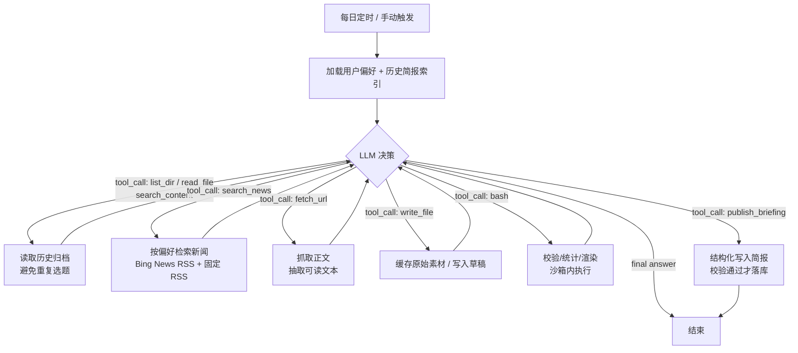

# PRD —— AI Daily：每日 AI 新闻助手 Agent

| 项 | 内容 |
|---|---|
| 版本 | v0.1（2026-10-20） |
| 作者 | 候选人（AI 辅助，Claude Code / DeepSeek Harness 工作流） |
| 对应题目 | 选项 A（Agent Loop：每日 AI 新闻助手） |
| 状态 | 已实现并验收 |

---

## 1. 背景与目标

### 1.1 题目原文拆解

> 用 AI coding 工具实现一个 Agent，每天自动为用户整理一份 AI 新闻简报并推送。用户可以按自己的偏好订阅（关注的话题、关键词），Agent 据此筛选内容。新闻从哪来（包括让模型自己去搜索）、推到哪里，都由你自己决定。

题目真正想考察的不是「把 RSS 拉下来拼字符串」，而是三件事：

1. **Agent 是否真的由 LLM 驱动**：工具调用顺序由模型决定，而不是硬编码的 `fetch → summarize → send` 流水线；
2. **工具集是否落地**：至少 5 个工具，且每个工具在真实业务里被用起来，而不是为了凑数；
3. **工程是否可交付**：一份评审 5 分钟能跑起来的仓库，有 Git 历史、环境变量、依赖清单、建表 SQL。

### 1.2 产品目标

让一个用户**只填一次偏好**，此后每天早晨收到一份「只包含自己关心话题」的 AI 新闻简报；并且这份简报是 Agent 用自己的判断从真实网页内容中筛选、核实、撰写出来的，每条内容都能追溯到原始链接。

### 1.3 成功标准（可验收）

- 评审按 README 操作，**5 分钟内**打开页面并成功生成第一份简报（无任何外部密钥时用 mock 模式；有 LLM Key 时用真实模型）；
- 运行轨迹页能逐条看到 **LLM 决定调用了哪个工具、参数是什么、观测结果是什么**；
- 连续两天的简报不重复推送同一批新闻（去重闭环）；
- 单测覆盖工具沙箱的越权路径、Agent 循环的非线性调用、偏好过滤与去重。

---

## 2. 用户与场景

### 2.1 目标用户

| 用户 | 痛点 | 本产品的价值 |
|---|---|---|
| 关注 AI 的开发者 / 产品经理 | 信息源太多（HN、Twitter、公众号、arXiv），筛选成本高 | 按话题+关键词订阅，只收到相关且已去重的几条 |
| 评审 | 无法快速判断「Agent 是不是真由 LLM 驱动」 | 运行轨迹页把每一步决策摊开可查 |

### 2.2 核心用户故事

- **US-1**：作为用户，我可以填写名字/邮箱并设置我关注的话题、关键词、排除词、每日条数，保存后生效。
- **US-2**：作为用户，我每天能自动收到一份简报（站内/飞书/邮件），每条包含标题、摘要、来源、链接、入选理由。
- **US-3**：作为用户，我可以查看历史简报，也能手动触发一次生成。
- **US-4**：作为评审，我可以查看一次运行的完整轨迹：每步的模型输出、工具名、参数、结果、耗时，从而确认调用顺序由 LLM 决定。
- **US-5**：作为运维/评审，我可以用一条命令在本地跑通全流程，并用测试证明关键行为。

---

## 3. 需求范围

### 3.1 P0（本次交付，全部实现）

| 编号 | 需求 | 说明 |
|---|---|---|
| F-1 | 用户身份与订阅偏好 | 名字、邮箱、话题、关键词、排除词、每日条数、推送时间、渠道；持久化到 SQLite |
| F-2 | Agent 自主研究并撰写简报 | 手写 function-calling ReAct 循环；模型自主决定工具调用顺序与停止时机；max_steps 兜底 |
| F-3 | 必需工具集（≥5） | `list_dir` / `read_file` / `search_content` / `write_file` / `bash`，全部沙箱化 |
| F-4 | 新闻领域工具 | `search_news`（Bing News RSS + 固定 RSS 源）、`fetch_url`（正文抽取）、`publish_briefing`（结构化落库校验） |
| F-5 | 偏好筛选与去重 | 关键词命中、排除词过滤、历史简报/历史 URL 去重、条数控制 |
| F-6 | 每日定时 + 手动触发 | APScheduler 每日任务 + Web 手动触发 + CLI 单次运行 |
| F-7 | 推送通道 | 站内（DB）、飞书群机器人 Webhook、SMTP 邮件；可插拔、失败降级 |
| F-8 | 前端页面 | 身份/偏好表单、历史简报、简报详情、运行轨迹、手动运行 |
| F-9 | 可观测性 | `agent_runs` / `agent_steps` / `deliveries` 全链路落库；前端可视化 |
| F-10 | 工程交付 | README 5 分钟跑通、`.env.example`、`requirements.txt`、`migrations/001_init.sql`、Git 分层提交 |

### 3.2 P1（时间允许则做，本次已做部分）

- `mock` 离线模式：零密钥体验完整 Agent 流程（**已做**，用于评审与 CI）；
- 运行历史 Token/耗时统计（已做）；
- CI 工作流（ruff + pytest）；
- 3 分钟演示录屏；
- 飞书推送卡片样式优化。

### 3.3 明确不做（Out of Scope）

- 用户注册/登录与权限体系（题目只要"填身份"，不做认证）；
- 向量检索/个性化推荐排序算法（用关键词+LLM 判断已足够）；
- 真实支付、多租户隔离、分布式任务队列；
- 移动端 App（题目要求是 Web 页面）。

---

## 4. 功能需求详述

### 4.1 订阅偏好

- `topics`：自由文本话题列表（如「AI Agent」「大模型开源」「算力芯片」）；
- `keywords`：更精确的关键词（如 `LangGraph`、`DeepSeek`、`MCP`）；
- `exclude_keywords`：排除词（如「融资」「八卦」）；
- `max_items`：每日条数 3–10；
- `channels`：`web` / `feishu` / `email`；
- `push_time`：每日推送时间（默认 08:00）。

**匹配规则**：标题/摘要命中 `keywords` 得高分；命中 `topics` 相关词次之；命中 `exclude_keywords` 直接剔除；最终由 LLM 在候选中做取舍并说明入选理由。

### 4.2 Agent 工作流（核心）

- 循环由 LLM 驱动：模型自己决定「先查历史还是先搜新闻」「搜几轮」「是否需要补抓正文」；
- 硬约束由框架层兜底：`max_steps`、单工具超时、token 预算、工具结果长度截断；
- 每次运行完整落库轨迹（thought / tool / args / result / duration）。

### 4.3 工具集（签名与用途）

| 工具 | 签名 | 在业务中的作用 |
|---|---|---|
| `list_dir` | `list_dir(path)` | 浏览归档目录（历史简报、素材缓存），了解有哪些记忆 |
| `read_file` | `read_file(path, offset=0, limit=8000)` | 读取历史简报/素材，做连续性与去重判断 |
| `search_content` | `search_content(keyword, dir)` | 在历史归档中按关键词检索，判断"这条新闻是否讲过" |
| `write_file` | `write_file(path, content)` | 落盘原始素材缓存、简报草稿、运行笔记 |
| `bash` | `bash(command, timeout=15)` | 沙箱内执行只读/统计类命令（字数统计、日期、渲染校验） |
| `search_news` | `search_news(query, days=2, limit=8)` | 新闻检索：Bing News RSS + 固定 RSS 源，返回标题/链接/来源/时间 |
| `fetch_url` | `fetch_url(url, max_chars=4000)` | 抓取正文并抽取可读文本，用于核实与摘要 |
| `publish_briefing` | `publish_briefing(title, summary, items[])` | 提交最终简报；服务端做结构校验并写库，成功后循环终止 |

> 说明：题面给出的 5 个工具按「必需工具集」实现；额外 3 个是新闻业务必需的自定义工具，符合"至少 5 个、签名自定"。

### 4.4 前端页面

单页（无构建步骤）四个区域：
1. **身份卡**：新建/切换用户；
2. **订阅偏好表单**：话题、关键词、排除词、条数、渠道、时间；
3. **简报区**：历史简报列表 + 详情（Markdown 渲染）；
4. **运行轨迹区**：运行状态、每步 thought/tool/result、Token 统计；手动触发按钮。

### 4.5 推送

| 渠道 | 实现 | 降级行为 |
|---|---|---|
| `web` | 写入 `briefings`，前端可见 | 始终可用（默认） |
| `feishu` | 群机器人 Webhook 发送摘要卡片 | Webhook 未配置 → 记 `skipped`，不影响主流程 |
| `email` | SMTP 发送 HTML 邮件 | 未配置/发送失败 → 记 `failed`，不影响主流程 |

---

## 5. 非功能需求

| 类别 | 要求 | 落地方式 |
|---|---|---|
| 安全 | 密钥不硬编码；bash/文件工具不可越权 | `.env` + `.gitignore`；工具目录 jail + 命令白名单 + 拒绝 `..`/绝对路径/符号链接逃逸 |
| 可运行性 | 评审 5 分钟跑通 | `pip install -r requirements.txt` → `cp .env.example .env` → `python -m app`；无密钥跑 mock |
| 可观测性 | 每次运行可复盘 | `agent_runs` / `agent_steps` / `deliveries` 落库 + 轨迹页 |
| 健壮性 | 单源失败不影响整体 | 每个新闻源独立 try/except；LLM 重试；推送失败降级 |
| 成本 | 可控 | `max_steps`、结果截断、token 统计、mock 模式用于联调 |
| 可维护性 | 代码可读、可测 | 分层（api/agent/tools/news/notify/services）；pytest 覆盖关键路径 |

---

## 6. 验收标准（对应题目逐条证明）

| 题目要求 | 证明方式 |
|---|---|
| 每天自动整理并推送 | `APScheduler` 每日任务 + 手动触发 + `deliveries` 记录；录屏演示 |
| 按偏好订阅/筛选 | 偏好表单 → 提示词注入 + 关键词过滤；单测 `test_preferences.py` |
| 工具集 ≥5 | 8 个工具，签名与业务用途见 §4.3；轨迹页可看到实际调用 |
| **工具调用顺序由 LLM 决定** | `app/agent/loop.py` 手写 function calling 循环；轨迹页展示每次模型决策；`test_agent_loop.py` 用假模型证明「不同偏好→不同调用序列」且无硬编码 |
| 前端页面 | `app/static/index.html`，可填身份/偏好、看历史简报 |
| 可运行仓库 + README | README「5 分钟快速开始」实测通过 |
| Git 历史/环境变量/依赖/建表 | 分层提交历史；`.env.example`；`requirements.txt`；`migrations/001_init.sql` |

---

## 7. 里程碑

| 阶段 | 内容 | 状态 |
|---|---|---|
| D0 | 需求分析、PRD、架构、ADR、Git 计划 | ✅ |
| D1 | 脚手架、配置、DB/migration、工具层、Agent 循环 | ✅ |
| D2 | 新闻源、简报服务、API、前端、调度、推送 | ✅ |
| D3 | 测试、README、演示录屏、说明、投递包 | ✅ |

## 8. 风险与对策

| 风险 | 对策 |
|---|---|
| LLM 输出不稳定/格式错误 | 结构化工具参数校验 + 失败重试 + `max_steps` 强制收敛 + 错误落库 |
| 新闻源反爬/不可达 | 多源降级（Bing News RSS ↔ 固定 RSS），单源失败不影响整体 |
| 评审环境无 API Key | mock 模式跑通全流程；真实模式需 `.env` 配置 |
| 去重不彻底导致重复推送 | 历史 URL 归一化 + 历史简报关键词检索（`search_content`）双保险 |
| 时间紧（3 天） | 严格 P0 范围；录屏与文档并行产出 |
